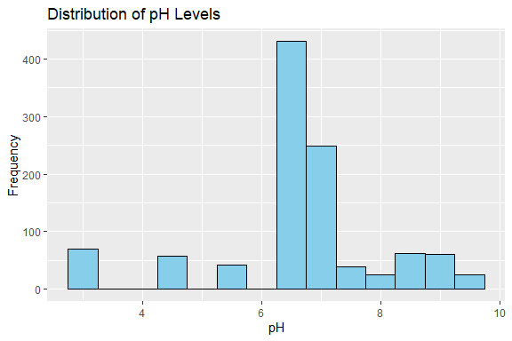
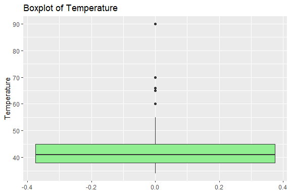
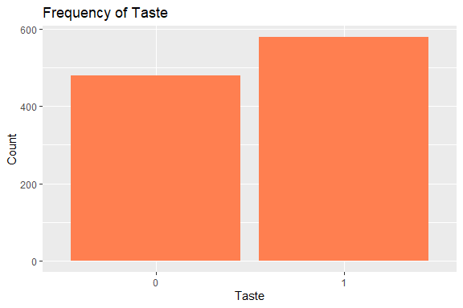
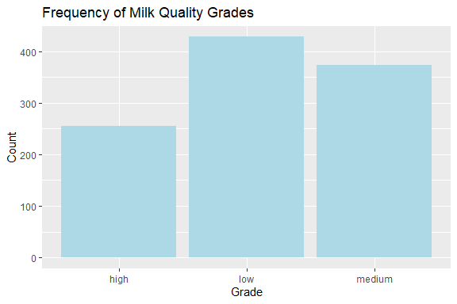
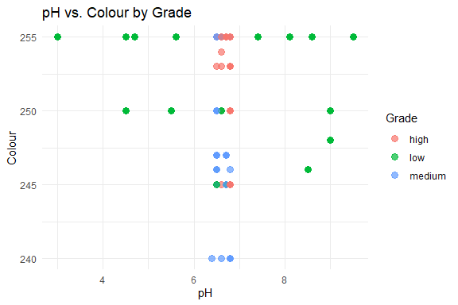
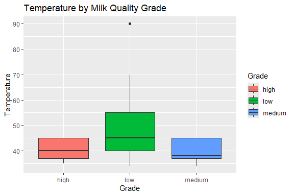
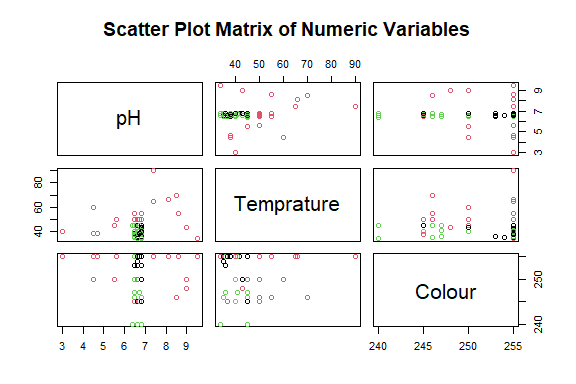
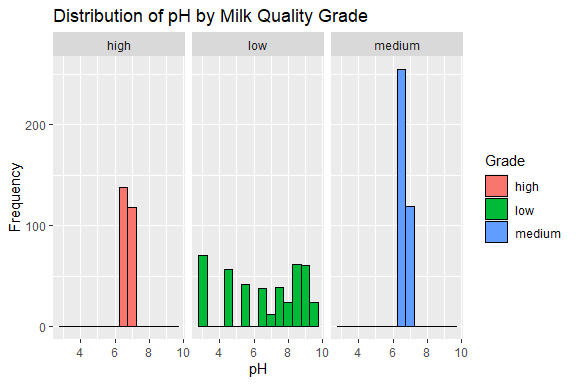
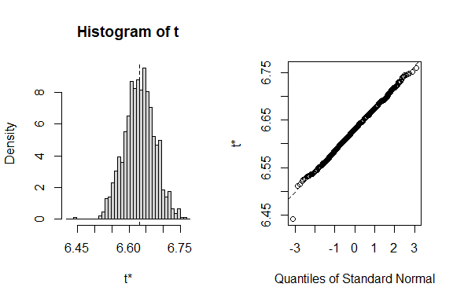

Milk Quality Prediction
================
Trevor Okinda
2024

- [Student Details](#student-details)
- [Setup Chunk](#setup-chunk)
  - [Source:](#source)
  - [Reference:](#reference)
- [Understanding the Dataset (Exploratory Data Analysis
  (EDA))](#understanding-the-dataset-exploratory-data-analysis-eda)
  - [Loading the Dataset](#loading-the-dataset)
  - [Measures of Frequency](#measures-of-frequency)
  - [Measures of Central Tendency](#measures-of-central-tendency)
  - [Measures of Distribution](#measures-of-distribution)
  - [Measures of Relationship](#measures-of-relationship)
  - [ANOVA](#anova)
  - [Plots](#plots)
- [Preprocessing and Data
  Transformation](#preprocessing-and-data-transformation)
  - [Missing Values](#missing-values)
- [Training Models](#training-models)
  - [Data Splitting](#data-splitting)
  - [Bootstrapping](#bootstrapping)
  - [Training Different Models](#training-different-models)
  - [Performance Comparison](#performance-comparison)
  - [Saving Model](#saving-model)

# Student Details

|                       |                         |
|-----------------------|-------------------------|
| **Student ID Number** | 134780                  |
| **Student Name**      | Trevor Okinda           |
| **BBIT 4.2 Group**    | C                       |
| **Project Name**      | Milk Quality Prediction |

# Setup Chunk

**Note:** the following KnitR options have been set as the global
defaults: <BR>
`knitr::opts_chunk$set(echo = TRUE, warning = FALSE, eval = TRUE, collapse = FALSE, tidy = TRUE)`.

More KnitR options are documented here
<https://bookdown.org/yihui/rmarkdown-cookbook/chunk-options.html> and
here <https://yihui.org/knitr/options/>.

### Source:

The dataset that was used can be downloaded here:
*\<<a href="https://www.kaggle.com/datasets/cpluzshrijayan/milkquality\"
class="uri">https://www.kaggle.com/datasets/cpluzshrijayan/milkquality\</a>\>*

### Reference:

*\<Rajendran, S. (n.d.). Milk Quality Prediction \[Data set\]. Kaggle.
<a href="https://www.kaggle.com/datasets/cpluzshrijayan/milkquality\"
class="uri">https://www.kaggle.com/datasets/cpluzshrijayan/milkquality\</a>\>  
Refer to the APA 7th edition manual for rules on how to cite datasets:
<https://apastyle.apa.org/style-grammar-guidelines/references/examples/data-set-references>*

# Understanding the Dataset (Exploratory Data Analysis (EDA))

## Loading the Dataset

``` r
# Load the dataset
MilkData <- read.csv("milknew.csv", colClasses = c(
  pH = "numeric",
  Temprature = "numeric",
  Taste = "factor",
  Odor = "factor",
  Fat = "factor",
  Turbidity = "factor",
  Colour = "numeric",
  Grade = "factor"
))

# Display structure to verify data types
str(MilkData)
```

    ## 'data.frame':    1059 obs. of  8 variables:
    ##  $ pH        : num  6.6 6.6 8.5 9.5 6.6 6.6 5.5 4.5 8.1 6.7 ...
    ##  $ Temprature: num  35 36 70 34 37 37 45 60 66 45 ...
    ##  $ Taste     : Factor w/ 2 levels "0","1": 2 1 2 2 1 2 2 1 2 2 ...
    ##  $ Odor      : Factor w/ 2 levels "0","1": 1 2 2 2 1 2 1 2 1 2 ...
    ##  $ Fat       : Factor w/ 2 levels "0","1": 2 1 2 1 1 2 2 2 2 1 ...
    ##  $ Turbidity : Factor w/ 2 levels "0","1": 1 2 2 2 1 2 2 2 2 1 ...
    ##  $ Colour    : num  254 253 246 255 255 255 250 250 255 247 ...
    ##  $ Grade     : Factor w/ 3 levels "high","low","medium": 1 1 2 2 3 1 2 2 2 3 ...

``` r
# Display first few rows to ensure data is loaded correctly
head(MilkData)
```

    ##    pH Temprature Taste Odor Fat Turbidity Colour  Grade
    ## 1 6.6         35     1    0   1         0    254   high
    ## 2 6.6         36     0    1   0         1    253   high
    ## 3 8.5         70     1    1   1         1    246    low
    ## 4 9.5         34     1    1   0         1    255    low
    ## 5 6.6         37     0    0   0         0    255 medium
    ## 6 6.6         37     1    1   1         1    255   high

``` r
View(MilkData)
```

## Measures of Frequency

``` r
# Frequency tables for categorical variables
table(MilkData$Taste)
```

    ## 
    ##   0   1 
    ## 480 579

``` r
table(MilkData$Odor)
```

    ## 
    ##   0   1 
    ## 601 458

``` r
table(MilkData$Fat)
```

    ## 
    ##   0   1 
    ## 348 711

``` r
table(MilkData$Turbidity)
```

    ## 
    ##   0   1 
    ## 539 520

``` r
table(MilkData$Grade)
```

    ## 
    ##   high    low medium 
    ##    256    429    374

## Measures of Central Tendency

``` r
# Mean
mean_pH <- mean(MilkData$pH, na.rm = TRUE)
mean_Temprature <- mean(MilkData$Temprature, na.rm = TRUE)
mean_Colour <- mean(MilkData$Colour, na.rm = TRUE)

# Median
median_pH <- median(MilkData$pH, na.rm = TRUE)
median_Temprature <- median(MilkData$Temprature, na.rm = TRUE)
median_Colour <- median(MilkData$Colour, na.rm = TRUE)

# Mode function (for simplicity, it assumes one mode)
get_mode <- function(v) {
  uniq_vals <- unique(v)
  uniq_vals[which.max(tabulate(match(v, uniq_vals)))]
}

mode_pH <- get_mode(MilkData$pH)
mode_Temprature <- get_mode(MilkData$Temprature)
mode_Colour <- get_mode(MilkData$Colour)

# Display results
mean_pH; mean_Temprature; mean_Colour
```

    ## [1] 6.630123

    ## [1] 44.22663

    ## [1] 251.8404

``` r
median_pH; median_Temprature; median_Colour
```

    ## [1] 6.7

    ## [1] 41

    ## [1] 255

``` r
mode_pH; mode_Temprature; mode_Colour
```

    ## [1] 6.8

    ## [1] 45

    ## [1] 255

## Measures of Distribution

``` r
# Variance
var_pH <- var(MilkData$pH, na.rm = TRUE)
var_Temprature <- var(MilkData$Temprature, na.rm = TRUE)
var_Colour <- var(MilkData$Colour, na.rm = TRUE)

# Standard Deviation
sd_pH <- sd(MilkData$pH, na.rm = TRUE)
sd_Temprature <- sd(MilkData$Temprature, na.rm = TRUE)
sd_Colour <- sd(MilkData$Colour, na.rm = TRUE)

# Range
range_pH <- range(MilkData$pH, na.rm = TRUE)
range_Temprature <- range(MilkData$Temprature, na.rm = TRUE)
range_Colour <- range(MilkData$Colour, na.rm = TRUE)

# Quantiles
quantiles_pH <- quantile(MilkData$pH, probs = c(0.25, 0.5, 0.75), na.rm = TRUE)
quantiles_Temprature <- quantile(MilkData$Temprature, probs = c(0.25, 0.5, 0.75), na.rm = TRUE)
quantiles_Colour <- quantile(MilkData$Colour, probs = c(0.25, 0.5, 0.75), na.rm = TRUE)

# Display results
var_pH; var_Temprature; var_Colour
```

    ## [1] 1.959101

    ## [1] 101.9769

    ## [1] 18.5539

``` r
sd_pH; sd_Temprature; sd_Colour
```

    ## [1] 1.399679

    ## [1] 10.09836

    ## [1] 4.307424

``` r
range_pH; range_Temprature; range_Colour
```

    ## [1] 3.0 9.5

    ## [1] 34 90

    ## [1] 240 255

``` r
quantiles_pH; quantiles_Temprature; quantiles_Colour
```

    ## 25% 50% 75% 
    ## 6.5 6.7 6.8

    ## 25% 50% 75% 
    ##  38  41  45

    ## 25% 50% 75% 
    ## 250 255 255

## Measures of Relationship

``` r
# Correlation between numeric variables
cor_matrix <- cor(MilkData[, c("pH", "Temprature", "Colour")], use = "complete.obs")

# Contingency tables for categorical variables
table_taste_grade <- table(MilkData$Taste, MilkData$Grade)
table_odor_grade <- table(MilkData$Odor, MilkData$Grade)

# Display results
cor_matrix
```

    ##                    pH  Temprature      Colour
    ## pH          1.0000000  0.24468406 -0.16456492
    ## Temprature  0.2446841  1.00000000 -0.00851136
    ## Colour     -0.1645649 -0.00851136  1.00000000

``` r
table_taste_grade
```

    ##    
    ##     high low medium
    ##   0   86 175    219
    ##   1  170 254    155

``` r
table_odor_grade
```

    ##    
    ##     high low medium
    ##   0   64 224    313
    ##   1  192 205     61

## ANOVA

``` r
# ANOVA for pH across different Grade levels
anova_pH <- aov(pH ~ Grade, data = MilkData)
summary(anova_pH)
```

    ##               Df Sum Sq Mean Sq F value Pr(>F)
    ## Grade          2    1.7   0.874   0.446  0.641
    ## Residuals   1056 2071.0   1.961

``` r
# ANOVA for Temprature across different Grade levels
anova_Temprature <- aov(Temprature ~ Grade, data = MilkData)
summary(anova_Temprature)
```

    ##               Df Sum Sq Mean Sq F value Pr(>F)    
    ## Grade          2  26634   13317   173.1 <2e-16 ***
    ## Residuals   1056  81258      77                   
    ## ---
    ## Signif. codes:  0 '***' 0.001 '**' 0.01 '*' 0.05 '.' 0.1 ' ' 1

``` r
# ANOVA for Colour across different Grade levels
anova_Colour <- aov(Colour ~ Grade, data = MilkData)
summary(anova_Colour)
```

    ##               Df Sum Sq Mean Sq F value Pr(>F)    
    ## Grade          2   1313   656.6   37.85 <2e-16 ***
    ## Residuals   1056  18317    17.3                   
    ## ---
    ## Signif. codes:  0 '***' 0.001 '**' 0.01 '*' 0.05 '.' 0.1 ' ' 1

``` r
# Post-hoc test for pH if ANOVA is significant
TukeyHSD(anova_pH)
```

    ##   Tukey multiple comparisons of means
    ##     95% family-wise confidence level
    ## 
    ## Fit: aov(formula = pH ~ Grade, data = MilkData)
    ## 
    ## $Grade
    ##                    diff        lwr       upr     p adj
    ## low-high    -0.10400004 -0.3635786 0.1555785 0.6148534
    ## medium-high -0.05755139 -0.3241677 0.2090649 0.8681312
    ## medium-low   0.04644865 -0.1860741 0.2789714 0.8859299

``` r
# Post-hoc test for Temprature if ANOVA is significant
TukeyHSD(anova_Temprature)
```

    ##   Tukey multiple comparisons of means
    ##     95% family-wise confidence level
    ## 
    ## Fit: aov(formula = Temprature ~ Grade, data = MilkData)
    ## 
    ## $Grade
    ##                    diff        lwr        upr     p adj
    ## low-high      9.6406068   8.014636 11.2665776 0.0000000
    ## medium-high  -0.9265124  -2.596567  0.7435419 0.3943065
    ## medium-low  -10.5671192 -12.023616 -9.1106227 0.0000000

``` r
# Post-hoc test for Colour if ANOVA is significant
TukeyHSD(anova_Colour)
```

    ##   Tukey multiple comparisons of means
    ##     95% family-wise confidence level
    ## 
    ## Fit: aov(formula = Colour ~ Grade, data = MilkData)
    ## 
    ## $Grade
    ##                   diff        lwr        upr     p adj
    ## low-high     0.1952032 -0.5767773  0.9671838 0.8236578
    ## medium-high -2.2021641 -2.9950746 -1.4092536 0.0000000
    ## medium-low  -2.3973673 -3.0888846 -1.7058501 0.0000000

## Plots

``` r
library(ggplot2)

# Histogram for pH
ggplot(MilkData, aes(x = pH)) +
  geom_histogram(binwidth = 0.5, fill = "skyblue", color = "black") +
  labs(title = "Distribution of pH Levels", x = "pH", y = "Frequency")
```

<!-- -->

``` r
# Boxplot for Temperature
ggplot(MilkData, aes(y = Temprature)) +
  geom_boxplot(fill = "lightgreen") +
  labs(title = "Boxplot of Temperature", y = "Temperature")
```

<!-- -->

``` r
# Bar plot for categorical variables (e.g., Taste)
ggplot(MilkData, aes(x = Taste)) +
  geom_bar(fill = "coral") +
  labs(title = "Frequency of Taste", x = "Taste", y = "Count")
```

<!-- -->

``` r
# Bar plot for Grade
ggplot(MilkData, aes(x = Grade)) +
  geom_bar(fill = "lightblue") +
  labs(title = "Frequency of Milk Quality Grades", x = "Grade", y = "Count")
```

<!-- -->

``` r
# Scatter plot of pH vs. Colour, colored by Grade
ggplot(MilkData, aes(x = pH, y = Colour, color = Grade)) +
  geom_point(size = 3, alpha = 0.7) +
  labs(title = "pH vs. Colour by Grade", x = "pH", y = "Colour") +
  theme_minimal()
```

<!-- -->

``` r
# Box plot of Temperature by Grade
ggplot(MilkData, aes(x = Grade, y = Temprature, fill = Grade)) +
  geom_boxplot() +
  labs(title = "Temperature by Milk Quality Grade", x = "Grade", y = "Temperature")
```

<!-- -->

``` r
# Scatter plot matrix for numeric variables (pH, Temperature, Colour)
pairs(MilkData[, c("pH", "Temprature", "Colour")], 
      main = "Scatter Plot Matrix of Numeric Variables", 
      col = as.numeric(MilkData$Grade))
```

<!-- -->

``` r
# Faceted histogram of pH by Grade
ggplot(MilkData, aes(x = pH, fill = Grade)) +
  geom_histogram(binwidth = 0.5, color = "black") +
  facet_wrap(~ Grade) +
  labs(title = "Distribution of pH by Milk Quality Grade", x = "pH", y = "Frequency")
```

<!-- -->

# Preprocessing and Data Transformation

## Missing Values

``` r
# Check for missing values in each column
colSums(is.na(MilkData))
```

    ##         pH Temprature      Taste       Odor        Fat  Turbidity     Colour 
    ##          0          0          0          0          0          0          0 
    ##      Grade 
    ##          0

``` r
# Alternatively, use the 'summary' function to get an overview, which also indicates missing values
summary(MilkData)
```

    ##        pH         Temprature    Taste   Odor    Fat     Turbidity
    ##  Min.   :3.00   Min.   :34.00   0:480   0:601   0:348   0:539    
    ##  1st Qu.:6.50   1st Qu.:38.00   1:579   1:458   1:711   1:520    
    ##  Median :6.70   Median :41.00                                    
    ##  Mean   :6.63   Mean   :44.23                                    
    ##  3rd Qu.:6.80   3rd Qu.:45.00                                    
    ##  Max.   :9.50   Max.   :90.00                                    
    ##      Colour         Grade    
    ##  Min.   :240.0   high  :256  
    ##  1st Qu.:250.0   low   :429  
    ##  Median :255.0   medium:374  
    ##  Mean   :251.8               
    ##  3rd Qu.:255.0               
    ##  Max.   :255.0

``` r
# Display rows with any missing values (if any exist)
MilkData[!complete.cases(MilkData), ]
```

    ## [1] pH         Temprature Taste      Odor       Fat        Turbidity  Colour    
    ## [8] Grade     
    ## <0 rows> (or 0-length row.names)

# Training Models

## Data Splitting

``` r
set.seed(123)  # For reproducibility
sample_index <- sample(seq_len(nrow(MilkData)), size = 0.7 * nrow(MilkData))
train_data <- MilkData[sample_index, ]
test_data <- MilkData[-sample_index, ]

# Check the size of the splits
nrow(train_data)
```

    ## [1] 741

``` r
nrow(test_data)
```

    ## [1] 318

## Bootstrapping

``` r
library(boot)

# Define a simple function to calculate the mean of pH as an example statistic
boot_mean <- function(data, indices) {
  sample_data <- data[indices, ]  # Resample data with replacement
  return(mean(sample_data$pH))
}

library(boot)
# Perform bootstrapping with 1000 resamples
set.seed(123)
boot_results <- boot(data = MilkData, statistic = boot_mean, R = 1000)

# View bootstrapped results
print(boot_results)
```

    ## 
    ## ORDINARY NONPARAMETRIC BOOTSTRAP
    ## 
    ## 
    ## Call:
    ## boot(data = MilkData, statistic = boot_mean, R = 1000)
    ## 
    ## 
    ## Bootstrap Statistics :
    ##     original        bias    std. error
    ## t1* 6.630123 -9.622285e-05   0.0442129

``` r
plot(boot_results)
```

<!-- -->

## Training Different Models

``` r
library(caret)
```

    ## Loading required package: lattice

    ## 
    ## Attaching package: 'lattice'

    ## The following object is masked from 'package:boot':
    ## 
    ##     melanoma

``` r
# Train a Logistic Regression model
set.seed(123)
log_reg_model <- train(
  Grade ~ ., 
  data = MilkData, 
  method = "multinom", 
  family = "binomial", 
  trControl = trainControl(method = "cv", number = 10)
)
```

    ## # weights:  27 (16 variable)
    ## initial  value 1046.977511 
    ## iter  10 value 625.043943
    ## iter  20 value 459.815784
    ## iter  30 value 402.685734
    ## iter  40 value 398.383548
    ## iter  50 value 393.932354
    ## iter  60 value 384.968550
    ## final  value 383.392382 
    ## converged
    ## # weights:  27 (16 variable)
    ## initial  value 1046.977511 
    ## iter  10 value 627.630830
    ## iter  20 value 512.784671
    ## iter  30 value 511.373552
    ## final  value 511.373519 
    ## converged
    ## # weights:  27 (16 variable)
    ## initial  value 1046.977511 
    ## iter  10 value 625.046556
    ## iter  20 value 459.994857
    ## iter  30 value 404.318841
    ## iter  40 value 400.140717
    ## iter  50 value 396.078727
    ## iter  60 value 388.670432
    ## final  value 387.657522 
    ## converged
    ## # weights:  27 (16 variable)
    ## initial  value 1045.878899 
    ## iter  10 value 655.983568
    ## iter  20 value 467.658823
    ## iter  30 value 403.759739
    ## iter  40 value 395.475810
    ## iter  50 value 393.856230
    ## iter  60 value 388.062633
    ## final  value 387.268224 
    ## converged
    ## # weights:  27 (16 variable)
    ## initial  value 1045.878899 
    ## iter  10 value 662.473972
    ## iter  20 value 518.849546
    ## iter  30 value 517.313882
    ## final  value 517.313633 
    ## converged
    ## # weights:  27 (16 variable)
    ## initial  value 1045.878899 
    ## iter  10 value 655.990193
    ## iter  20 value 467.817188
    ## iter  30 value 405.444260
    ## iter  40 value 397.531682
    ## iter  50 value 396.272650
    ## iter  60 value 391.664253
    ## final  value 391.212062 
    ## converged
    ## # weights:  27 (16 variable)
    ## initial  value 1046.977511 
    ## iter  10 value 657.154179
    ## iter  20 value 470.226391
    ## iter  30 value 404.617717
    ## iter  40 value 397.395598
    ## iter  50 value 395.152601
    ## iter  60 value 387.664139
    ## final  value 386.637522 
    ## converged
    ## # weights:  27 (16 variable)
    ## initial  value 1046.977511 
    ## iter  10 value 664.387924
    ## iter  20 value 516.407030
    ## iter  30 value 514.890626
    ## final  value 514.890365 
    ## converged
    ## # weights:  27 (16 variable)
    ## initial  value 1046.977511 
    ## iter  10 value 657.161568
    ## iter  20 value 470.357130
    ## iter  30 value 406.272086
    ## iter  40 value 399.433652
    ## iter  50 value 397.377130
    ## iter  60 value 391.391943
    ## final  value 390.729802 
    ## converged
    ## # weights:  27 (16 variable)
    ## initial  value 1048.076123 
    ## iter  10 value 659.598429
    ## iter  20 value 462.020074
    ## iter  30 value 404.967354
    ## iter  40 value 399.794270
    ## iter  50 value 397.243494
    ## iter  60 value 389.314357
    ## final  value 388.283335 
    ## converged
    ## # weights:  27 (16 variable)
    ## initial  value 1048.076123 
    ## iter  10 value 640.656464
    ## iter  20 value 515.977322
    ## iter  30 value 514.095895
    ## final  value 514.095660 
    ## converged
    ## # weights:  27 (16 variable)
    ## initial  value 1048.076123 
    ## iter  10 value 659.602594
    ## iter  20 value 462.220453
    ## iter  30 value 406.611871
    ## iter  40 value 401.507355
    ## iter  50 value 399.284900
    ## iter  60 value 392.823901
    ## final  value 392.166755 
    ## converged
    ## # weights:  27 (16 variable)
    ## initial  value 1046.977511 
    ## iter  10 value 614.779156
    ## iter  20 value 448.328350
    ## iter  30 value 386.843005
    ## iter  40 value 384.825432
    ## iter  50 value 382.017419
    ## iter  60 value 373.910311
    ## iter  70 value 371.339112
    ## iter  80 value 371.338054
    ## iter  90 value 371.337021
    ## final  value 371.336584 
    ## converged
    ## # weights:  27 (16 variable)
    ## initial  value 1046.977511 
    ## iter  10 value 617.419353
    ## iter  20 value 501.772473
    ## iter  30 value 500.329265
    ## final  value 500.329205 
    ## converged
    ## # weights:  27 (16 variable)
    ## initial  value 1046.977511 
    ## iter  10 value 614.781822
    ## iter  20 value 448.507975
    ## iter  30 value 388.859261
    ## iter  40 value 386.988323
    ## iter  50 value 383.842838
    ## iter  60 value 377.443982
    ## iter  70 value 376.937624
    ## iter  80 value 376.889513
    ## iter  90 value 376.157387
    ## iter 100 value 376.026956
    ## final  value 376.026956 
    ## stopped after 100 iterations
    ## # weights:  27 (16 variable)
    ## initial  value 1048.076123 
    ## iter  10 value 621.460318
    ## iter  20 value 447.820661
    ## iter  30 value 394.717738
    ## iter  40 value 391.292130
    ## iter  50 value 387.216912
    ## iter  60 value 379.302549
    ## final  value 378.302954 
    ## converged
    ## # weights:  27 (16 variable)
    ## initial  value 1048.076123 
    ## iter  10 value 624.071367
    ## iter  20 value 503.200202
    ## iter  30 value 501.589841
    ## final  value 501.589753 
    ## converged
    ## # weights:  27 (16 variable)
    ## initial  value 1048.076123 
    ## iter  10 value 621.462955
    ## iter  20 value 448.020128
    ## iter  30 value 396.383367
    ## iter  40 value 392.914103
    ## iter  50 value 389.313879
    ## iter  60 value 382.896157
    ## final  value 382.307653 
    ## converged
    ## # weights:  27 (16 variable)
    ## initial  value 1045.878899 
    ## iter  10 value 623.666862
    ## iter  20 value 459.535455
    ## iter  30 value 400.097795
    ## iter  40 value 395.726798
    ## iter  50 value 392.702990
    ## iter  60 value 384.379818
    ## final  value 383.367942 
    ## converged
    ## # weights:  27 (16 variable)
    ## initial  value 1045.878899 
    ## iter  10 value 626.161937
    ## iter  20 value 509.047870
    ## iter  30 value 507.646118
    ## final  value 507.645849 
    ## converged
    ## # weights:  27 (16 variable)
    ## initial  value 1045.878899 
    ## iter  10 value 623.669381
    ## iter  20 value 459.717780
    ## iter  30 value 401.681095
    ## iter  40 value 397.547306
    ## iter  50 value 394.717107
    ## iter  60 value 387.834928
    ## final  value 387.211231 
    ## converged
    ## # weights:  27 (16 variable)
    ## initial  value 1046.977511 
    ## iter  10 value 642.705250
    ## iter  20 value 461.711559
    ## iter  30 value 397.411345
    ## iter  40 value 391.155257
    ## iter  50 value 390.041186
    ## iter  60 value 382.985273
    ## final  value 382.845001 
    ## converged
    ## # weights:  27 (16 variable)
    ## initial  value 1046.977511 
    ## iter  10 value 650.278609
    ## iter  20 value 508.392768
    ## iter  30 value 507.022397
    ## final  value 507.022127 
    ## converged
    ## # weights:  27 (16 variable)
    ## initial  value 1046.977511 
    ## iter  10 value 642.713003
    ## iter  20 value 461.847585
    ## iter  30 value 399.067138
    ## iter  40 value 393.311497
    ## iter  50 value 392.289163
    ## iter  60 value 386.619189
    ## final  value 386.565148 
    ## converged
    ## # weights:  27 (16 variable)
    ## initial  value 1046.977511 
    ## iter  10 value 638.000855
    ## iter  20 value 469.913892
    ## iter  30 value 407.962253
    ## iter  40 value 403.589877
    ## iter  50 value 399.553255
    ## iter  60 value 390.565808
    ## iter  70 value 388.843326
    ## iter  80 value 388.827225
    ## iter  90 value 388.824810
    ## final  value 388.824800 
    ## converged
    ## # weights:  27 (16 variable)
    ## initial  value 1046.977511 
    ## iter  10 value 642.314260
    ## iter  20 value 514.181810
    ## iter  30 value 513.173740
    ## final  value 513.173711 
    ## converged
    ## # weights:  27 (16 variable)
    ## initial  value 1046.977511 
    ## iter  10 value 638.005251
    ## iter  20 value 470.040103
    ## iter  30 value 409.494595
    ## iter  40 value 405.135392
    ## iter  50 value 401.549287
    ## iter  60 value 394.019262
    ## final  value 392.910643 
    ## converged
    ## # weights:  27 (16 variable)
    ## initial  value 1048.076123 
    ## iter  10 value 644.796523
    ## iter  20 value 461.160083
    ## iter  30 value 402.845622
    ## iter  40 value 398.945419
    ## iter  50 value 396.039209
    ## iter  60 value 387.926016
    ## final  value 387.276542 
    ## converged
    ## # weights:  27 (16 variable)
    ## initial  value 1048.076123 
    ## iter  10 value 648.835132
    ## iter  20 value 512.784327
    ## iter  30 value 511.600394
    ## final  value 511.600327 
    ## converged
    ## # weights:  27 (16 variable)
    ## initial  value 1048.076123 
    ## iter  10 value 644.800640
    ## iter  20 value 461.309042
    ## iter  30 value 404.495923
    ## iter  40 value 400.731072
    ## iter  50 value 397.969983
    ## iter  60 value 391.384200
    ## final  value 391.000779 
    ## converged
    ## # weights:  27 (16 variable)
    ## initial  value 1163.430414 
    ## iter  10 value 707.882449
    ## iter  20 value 504.039998
    ## iter  30 value 446.062235
    ## iter  40 value 442.250094
    ## iter  50 value 439.247465
    ## iter  60 value 431.798229
    ## final  value 431.188040 
    ## converged

``` r
# Print summary of model
print(log_reg_model)
```

    ## Penalized Multinomial Regression 
    ## 
    ## 1059 samples
    ##    7 predictor
    ##    3 classes: 'high', 'low', 'medium' 
    ## 
    ## No pre-processing
    ## Resampling: Cross-Validated (10 fold) 
    ## Summary of sample sizes: 953, 952, 953, 954, 953, 954, ... 
    ## Resampling results across tuning parameters:
    ## 
    ##   decay  Accuracy   Kappa    
    ##   0e+00  0.8508124  0.7729314
    ##   1e-04  0.8517648  0.7743585
    ##   1e-01  0.7562460  0.6258395
    ## 
    ## Accuracy was used to select the optimal model using the largest value.
    ## The final value used for the model was decay = 1e-04.

``` r
library(randomForest)
```

    ## randomForest 4.7-1.1

    ## Type rfNews() to see new features/changes/bug fixes.

    ## 
    ## Attaching package: 'randomForest'

    ## The following object is masked from 'package:ggplot2':
    ## 
    ##     margin

``` r
set.seed(123)
rf_model <- train(
  Grade ~ ., 
  data = MilkData, 
  method = "rf", 
  trControl = trainControl(method = "cv", number = 10)
)
print(rf_model)
```

    ## Random Forest 
    ## 
    ## 1059 samples
    ##    7 predictor
    ##    3 classes: 'high', 'low', 'medium' 
    ## 
    ## No pre-processing
    ## Resampling: Cross-Validated (10 fold) 
    ## Summary of sample sizes: 953, 952, 953, 954, 953, 954, ... 
    ## Resampling results across tuning parameters:
    ## 
    ##   mtry  Accuracy   Kappa    
    ##   2     0.9981042  0.9971022
    ##   4     0.9971696  0.9956694
    ##   7     0.9952917  0.9927931
    ## 
    ## Accuracy was used to select the optimal model using the largest value.
    ## The final value used for the model was mtry = 2.

``` r
set.seed(123)
svm_model <- train(
  Grade ~ ., 
  data = MilkData, 
  method = "svmRadial", 
  trControl = trainControl(method = "cv", number = 10)
)
print(svm_model)
```

    ## Support Vector Machines with Radial Basis Function Kernel 
    ## 
    ## 1059 samples
    ##    7 predictor
    ##    3 classes: 'high', 'low', 'medium' 
    ## 
    ## No pre-processing
    ## Resampling: Cross-Validated (10 fold) 
    ## Summary of sample sizes: 953, 952, 953, 954, 953, 954, ... 
    ## Resampling results across tuning parameters:
    ## 
    ##   C     Accuracy   Kappa    
    ##   0.25  0.8998800  0.8477186
    ##   0.50  0.9234924  0.8834968
    ##   1.00  0.9442749  0.9151990
    ## 
    ## Tuning parameter 'sigma' was held constant at a value of 0.08931156
    ## Accuracy was used to select the optimal model using the largest value.
    ## The final values used for the model were sigma = 0.08931156 and C = 1.

## Performance Comparison

``` r
# Combine models into a list
models <- resamples(list(Logistic_Regression = log_reg_model,
                         Random_Forest = rf_model,
                         SVM = svm_model))

# Summary of the resamples to view performance metrics
summary(models)
```

    ## 
    ## Call:
    ## summary.resamples(object = models)
    ## 
    ## Models: Logistic_Regression, Random_Forest, SVM 
    ## Number of resamples: 10 
    ## 
    ## Accuracy 
    ##                          Min.   1st Qu.    Median      Mean   3rd Qu.      Max.
    ## Logistic_Regression 0.8285714 0.8329219 0.8490566 0.8517648 0.8688503 0.8761905
    ## Random_Forest       0.9904762 1.0000000 1.0000000 0.9981042 1.0000000 1.0000000
    ## SVM                 0.9238095 0.9334906 0.9389878 0.9442749 0.9599057 0.9714286
    ##                     NA's
    ## Logistic_Regression    0
    ## Random_Forest          0
    ## SVM                    0
    ## 
    ## Kappa 
    ##                          Min.   1st Qu.    Median      Mean   3rd Qu.      Max.
    ## Logistic_Regression 0.7366096 0.7466247 0.7700302 0.7743585 0.8022824 0.8129368
    ## Random_Forest       0.9854812 1.0000000 1.0000000 0.9971022 1.0000000 1.0000000
    ## SVM                 0.8836726 0.8990961 0.9070495 0.9151990 0.9389540 0.9563591
    ##                     NA's
    ## Logistic_Regression    0
    ## Random_Forest          0
    ## SVM                    0

``` r
# Boxplots to visualize the comparison of models
bwplot(models)
```

<!-- -->

``` r
# Additional metrics comparison (Accuracy, Kappa, etc.)
dotplot(models)
```

<!-- -->

## Saving Model

``` r
# Load the saved model
loaded_rf_model <- readRDS("./models/saved_rf_model.rds")

# Model predicts Grade (milk quality)
new_data <- data.frame(
  pH = 6.6,
  Temprature = 35,
  Taste = factor(1, levels = c(0, 1)),  # Adjust levels 
  Odor = factor(0, levels = c(0, 1)),    # Adjust levels 
  Fat = factor(1, levels = c(0, 1)),     # Adjust levels 
  Turbidity = factor(0, levels = c(0, 1)),# Adjust levels 
  Colour = 254
)

# Use the loaded model to make predictions
predictions_loaded_model <- predict(loaded_rf_model, newdata = new_data)

# Print predictions
print(predictions_loaded_model)
```

    ## [1] high
    ## Levels: high low medium
